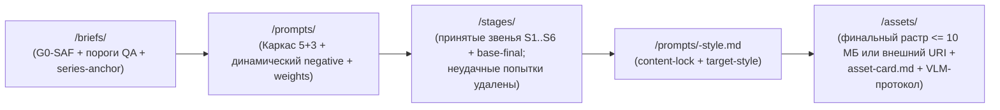

# Архитектура домена `picture`

Самодостаточный домен промптовой генерации изображений (`KIT-0003`). Не вложен в `narrative` и не опирается на другие предметные домены каркаса (`PIC-POL-06`).

## Рабочий корень `<picture_root>` в HYAI и в проектах-потребителях

Корень данных домена обозначается `<picture_root>` и задаётся полем `root_paths` манифеста активного домена `picture`:

| Режим использования | Значение `<picture_root>` | Как задаётся |
| --- | --- | --- |
| Собственный репозиторий `HYAI` | `HYAI/core/domains/picture/pictures` | `root_paths` в `HYAI/core/domains/picture/manifest.yaml` и запись `"HYAI/core/domains/picture/pictures/**": picture` в `HYAI/meta/manifest.yaml` |
| Внешний проект с подмодулем `HYAI` (например, `Eidolon---Pherin`) | Собственный каталог проекта вне подмодуля (например, `meta/hyai/domains/picture/pictures`) | Проектный манифест активного домена `meta/hyai/domains/picture/manifest.yaml` с `includes: ["HYAI/core/domains/picture/manifest.yaml"]` и своим `root_paths` (либо `active[].root_paths`) + запись `"meta/hyai/domains/picture/pictures/**": picture` в `meta/manifest.yaml` |

При переопределении `root_paths` во внешнем проекте движки каркаса автоматически ребазируют `scope_primary` / `scope_secondary` унаследованных профилей, `applies_to` правил `lint_terms.py` и `defaults_by_dir` схемы `frontmatter.py` с шаблонного пути каркаса на фактический `<picture_root>` проекта, а `check_domains.py`, `check_manifest.py` и `check_indexes.py` отвергают попытку направить активный домен или его `path_map` внутрь подмодуля HYAI.

## Раскладка рабочего каталога `<picture_root>/`

| Подкаталог | Уровень `authority` | Что хранится | Кто ведёт (основной профиль) |
| --- | --- | --- | --- |
| `<picture_root>/briefs/` | `brief`, `visual-canon` | Брифы задач и сессий с явными правилами безопасности (`G0-SAF`), эталоны серий (`series-anchor`) и спецификации отложенного фильтра стиля | `picture/art-director` |
| `<picture_root>/prompts/` | `prompt` | Моноязычные спецификации промптов по структуре «5+3», карты весов, динамические `negative` и текстовые журналы итераций | `picture/instant` |
| `<picture_root>/stages/` | `stage` | **Только принятые** промежуточные звенья (`S1..S6`), проверенные конечные базовые кадры `base-final` (`S7`) и манифесты `pipeline-manifest.md` | `picture/pipeline` |
| `<picture_root>/assets/` | `stage` | Финальные изображения после `style-filter` (`S8`) и их паспорта `asset-card.md` с протоколами VLM-приёмки и `person_disclaimer` | `picture/instant`, `picture/pipeline` |

## Архитектурные инварианты (`PIC-INV-*`)

| ID | Инвариант | Чем обеспечивается |
| --- | --- | --- |
| `PIC-INV-01` | Ни одно изображение (звено, базовый кадр, стилизованный финал) не существует без породившего его документа промпта в `<picture_root>/prompts/` | `PIC-POL-01`, шаблоны `prompt-spec.md` и `asset-card.md`, `check_links.py` |
| `PIC-INV-02` | Без четырёх явно заданных пользователем правил безопасности (`NSFW`, `Copyright`, `Person`, `Violence`) в `<picture_root>/prompts/`, `<picture_root>/stages/` и `<picture_root>/assets/` не создаётся ни одного рабочего артефакта задачи | Ворота `G0-SAF` (`PIC-SAF-01`), правило `pic.unset-safety-placeholder` в `lint_terms.py` |
| `PIC-INV-03` | Каталог `<picture_root>/stages/` хранит полный след принятых промежуточных звеньев и `base-final`, но нулевой объём отбракованных промежуточных рендеров | `PIC-POL-04`, правило `pic.rejected-artifact-stored` в `lint_terms.py` |
| `PIC-INV-04` | Художественный фильтр стиля отделён от синтеза содержания барьером `base-final`: все звенья до `base-final` включительно имеют `style_phase: base-neutral`, а `target-style` применяется только финальным проходом | `PIC-POL-05`, процесс `picture/style-filter`, правило `pic.premature-style-on-base` |
| `PIC-INV-05` | При подключении HYAI как подмодуля `<picture_root>` и `path_map` активного домена `picture` лежат строго вне подмодуля HYAI | `PIC-POL-06`, `check_domains.py`, `check_manifest.py`, `check_indexes.py` |

## Жизненный цикл данных между потоками

При размере растрового файла свыше `artifacts.no_binaries_over_mb` (`10 МБ`, `HYAI-ART-19`) бинарный оригинал хранится во внешнем хранилище проекта, а в `<picture_root>/stages/` и `<picture_root>/assets/` фиксируются Markdown-паспорта с `sha256`, размерами и постоянной ссылкой.
