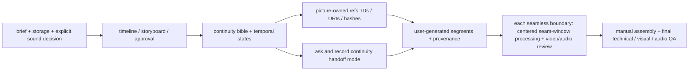

# Архитектура домена `video`

Видеодомен задаёт процедуры производства/приёмки и собственные временные инварианты, но не исполняет генератор. Междоменная граница с `picture` закреплена `P-0003`; модель домена и первая раскладка — `KIT-0004`.

## Корни и ownership

| Артефакт | Владелец | Где хранится/как используется |
| --- | --- | --- |
| Raster references, character/location sheets, storyboard/keyframes | `picture` | В picture root; video хранит ID/URI/hash + роль ссылки, без binary copy (`VID-POL-08`) |
| Brief, timeline, states, sound plan, transition windows, segment records, assembly/delivery docs | `video` | `<video_root>` из `root_paths`; в самом HYAI `HYAI/core/domains/video/videos/` |
| Сгенерированные video/audio binaries | Project storage policy | В согласованном хранилище, доступ и retention заданы заранее (`VID-POL-03`) |
| API/renderer code, dependencies, automation | Вне scope | HYAI guide instructs user but не подключает их (`VID-POL-10`) |

Во внешнем проекте, подключающем HYAI подмодулем, активный domain manifest должен переопределить `<video_root>` вне подмодуля, так же как для `picture` (`VID-POL-03`, `VID-INV-05`).

## Жизненный цикл проекта

## Domain rules

| ID | Invariant / criterion | Where enforced |
| --- | --- | --- |
| `VID-INV-01` | Audio requirement is explicitly answered; default=yes is only a proposed default, not consent | `VID-POL-02`, brief + `video.unset-audio-answer` |
| `VID-INV-02` | Storage location/access/retention is set at project level or approved for session before media | `VID-POL-03`, storage policy template |
| `VID-INV-03` | Segment continuity mode is asked and its real capability distinguished from static I2V reference | `VID-POL-04`, segment record |
| `VID-INV-04` | Every boundary has a declared edit/continuity type; every requested seamless boundary has a separately processed and reviewed centered window | `VID-POL-06..07`, seam-window template |
| `VID-INV-05` | `video` owns temporal documents and clips, `picture` owns raster/keyframe binaries; video links are content-addressed and non-duplicated | `VID-POL-08`, `P-0003` |
| `VID-INV-06` | Domain only provides guidance; no external renderer integration or fabricated completion claim | `VID-POL-10` |
| `VID-QA-01` | Project brief and approval gates are complete before generation | `VID-WF-01` |
| `VID-QA-02` | User explicitly answered sound yes/no; if yes, required audio plan exists | `VID-POL-02`, `VID-WF-03` |
| `VID-QA-03` | Storage and retention policy resolved before media | `VID-POL-03` |
| `VID-QA-04` | Segment handoff and actual references are recorded in segment sidecar | `VID-POL-04`, `VID-POL-12` |
| `VID-QA-05` | Seam-window has frame/time bounds, chosen method and evidence of processing | `VID-POL-07` |
| `VID-QA-06` | Seam-window reviewed in context by human; audio playback separately if required | `VID-POL-07`, `VID-POL-09`, `VID-POL-11` |
| `VID-QA-07` | Technical checks (decode/timing/fps/resolution/frame count/order) are not substituted for visual/audio review | `VID-POL-12` |
| `VID-QA-08` | Final delivery respects storage/access rules and has human disposition | `VID-POL-03`, `VID-POL-11..12` |
| `VID-WF-01` | Intake resolves project/session policy, requirements and delivery format | `workflows/production.md` |
| `VID-WF-02` | Continuity plans distinguish intentional cuts from continuation and process every requested seamless window | `workflows/continuity.md` |
| `VID-WF-03` | Sound workflow asks explicit yes/no with default yes and maps approved layers | `workflows/sound.md` |
| `VID-WF-04` | Assembly is manual, requires approved segments/windows and separate technical/visual/audio review | `workflows/assembly.md` |

## Non-goals

- No automatic image/video/audio generation, API/ComfyUI integration, FFmpeg execution or new dependencies.
- No guarantee that a model produces seamless motion; the contract requires a dedicated seam treatment and honest review, not a quality promise.
- No keyframe binary ownership or duplicate image workflow in `video`.
- No assumption that every scene transition should be continuous; cuts remain valid when explicitly intended.
